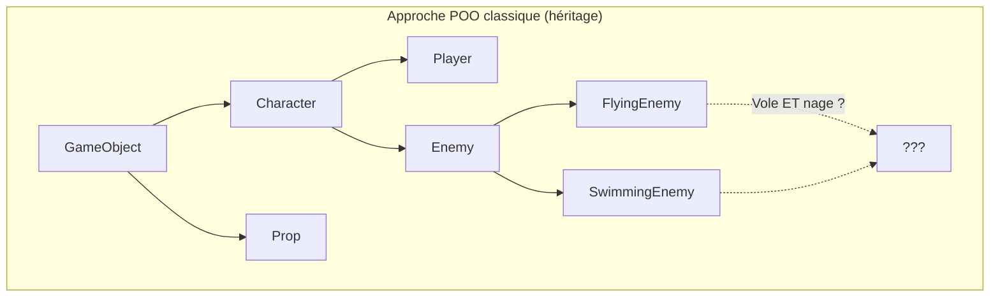
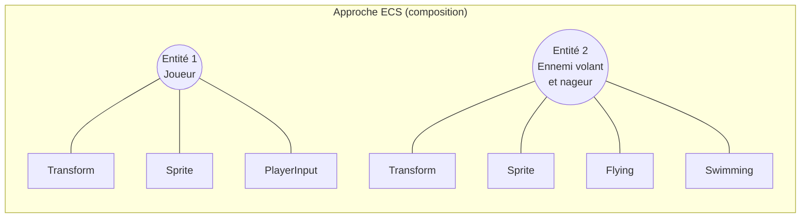
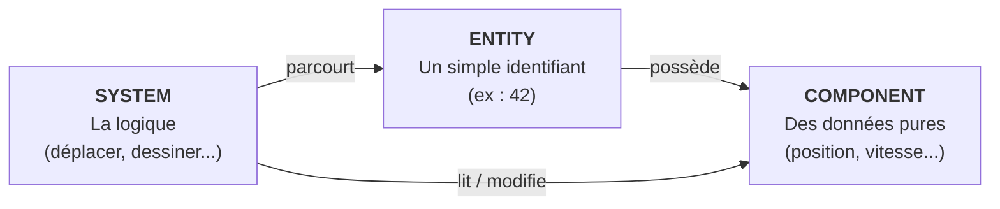
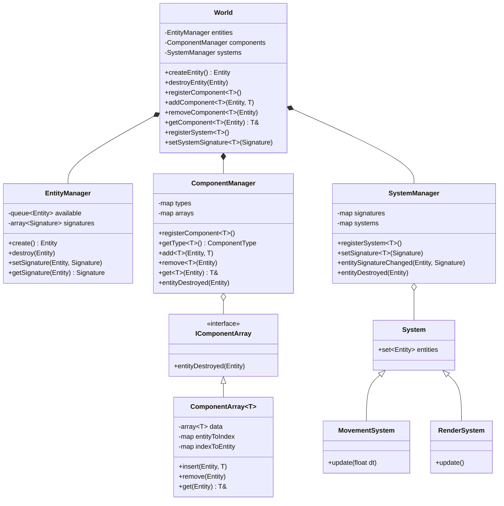
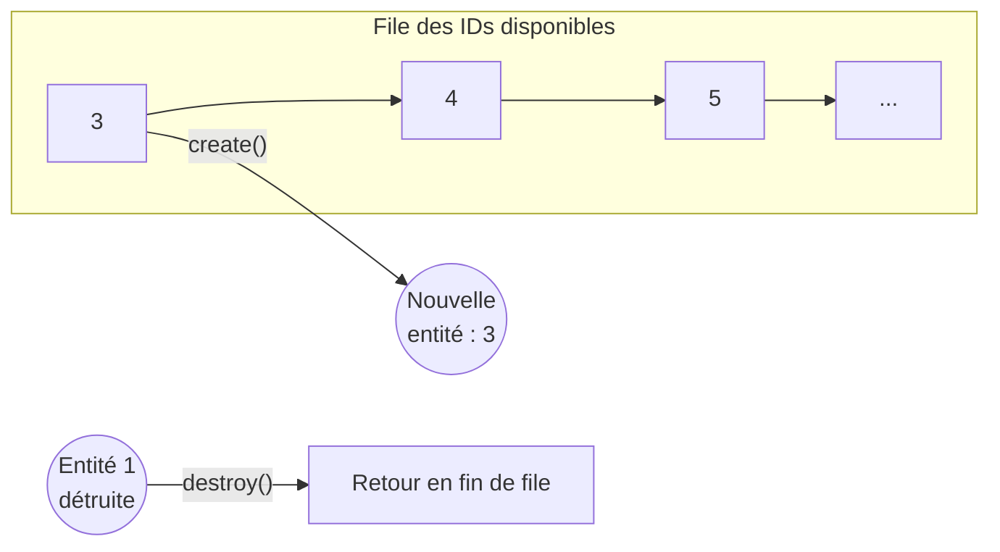
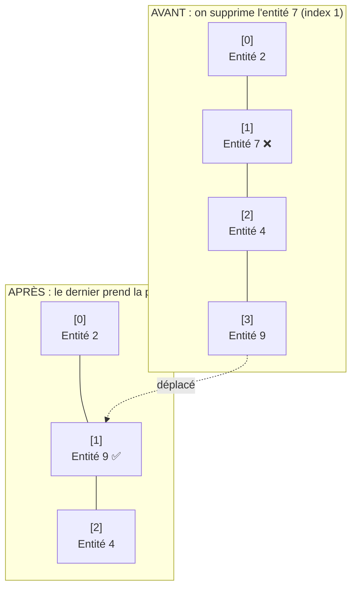
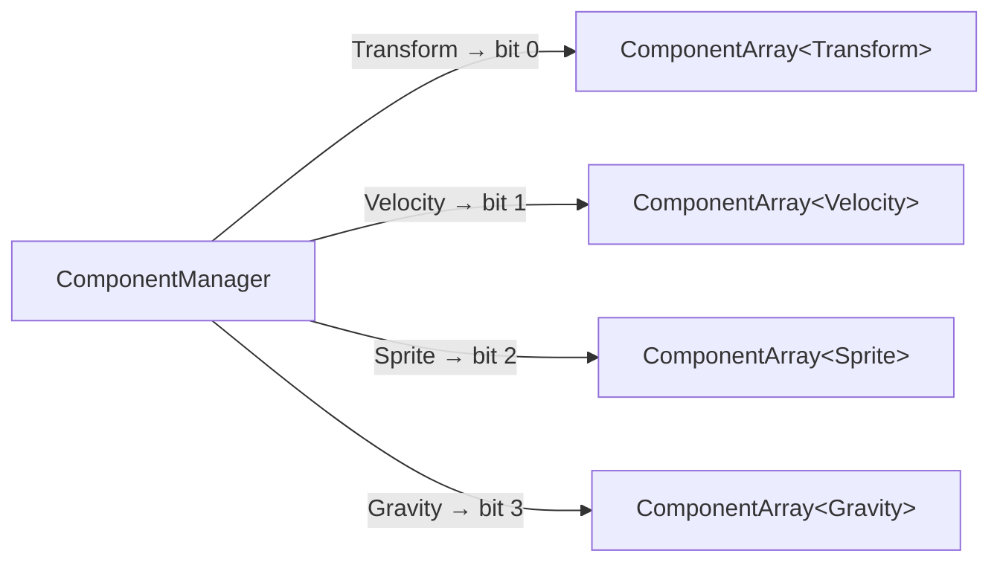
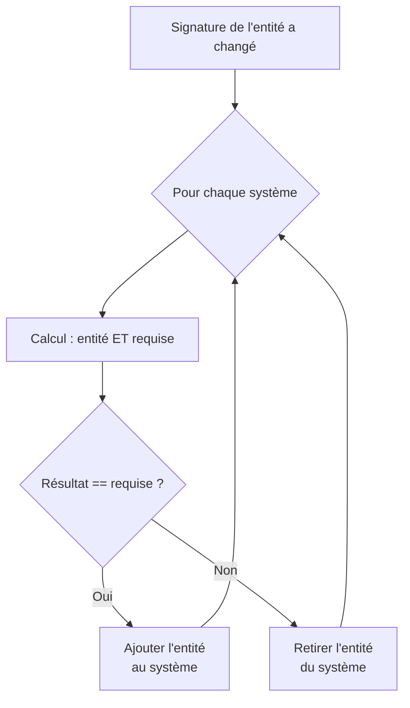
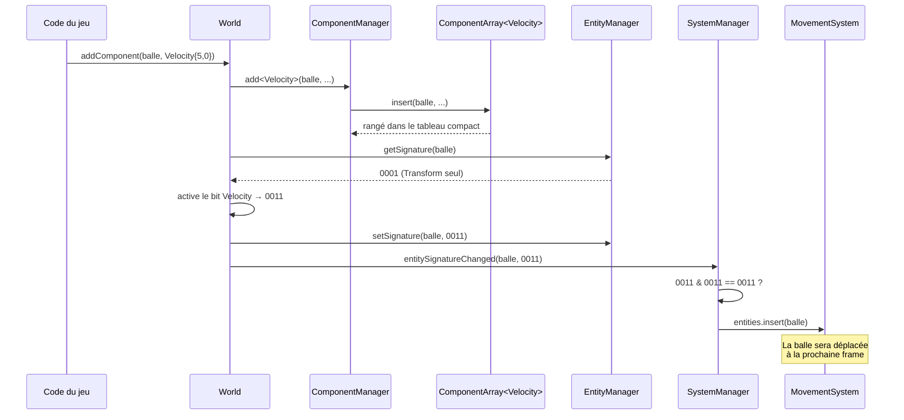
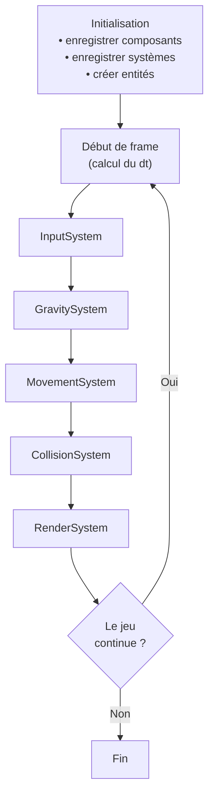

# Entity Component System (ECS) — Guide d'implémentation

> Documentation pour implémenter un ECS simple en C++ dans un moteur de jeu.

---

## Sommaire

1. [Pourquoi un ECS ?](#1-pourquoi-un-ecs-)
2. [Les trois notions de base](#2-les-trois-notions-de-base)
3. [Vue d'ensemble de l'architecture](#3-vue-densemble-de-larchitecture)
4. [Entity et Signature](#4-entity-et-signature)
5. [EntityManager](#5-entitymanager)
6. [Les Components](#6-les-components)
7. [ComponentArray](#7-componentarray)
8. [ComponentManager](#8-componentmanager)
9. [System](#9-system)
10. [SystemManager](#10-systemmanager)
11. [World (Coordinator)](#11-world-coordinator)
12. [Exemple complet](#12-exemple-complet)
13. [Le flux complet](#13-le-flux-complet)
14. [Pour aller plus loin](#14-pour-aller-plus-loin)

---

## 1. Pourquoi un ECS ?

Dans une approche orientée objet classique, on construit une hiérarchie d'héritage. Le problème apparaît vite : que faire d'un ennemi qui vole **et** nage ? On finit avec une hiérarchie rigide et difficile à faire évoluer.



L'ECS remplace l'héritage par la **composition** : une entité est définie par les composants qu'elle possède.



Les avantages principaux :

| Avantage | Explication |
|---|---|
| **Flexibilité** | On crée de nouveaux types d'objets en combinant des composants, sans toucher au code. |
| **Performance** | Les données d'un même type sont stockées côte à côte en mémoire, ce qui exploite bien le cache du processeur. |
| **Séparation claire** | Les données (components) et la logique (systems) sont séparées. |
| **Parallélisme** | Des systèmes indépendants peuvent tourner sur plusieurs threads. |

---

## 2. Les trois notions de base



- **Entity** : juste un numéro. Elle ne contient rien par elle-même.
- **Component** : une structure de données, sans aucune logique.
- **System** : une classe qui agit sur toutes les entités possédant un certain ensemble de composants.

---

## 3. Vue d'ensemble de l'architecture

Voici toutes les classes à créer et leurs relations :



Le `World` est la **seule** classe que le reste du moteur utilise. Il délègue le travail aux trois managers.

---

## 4. Entity et Signature

Une entité n'est qu'un nombre entier. La **signature** est un masque de bits : chaque bit correspond à un type de composant.

```cpp
#pragma once
#include <bitset>
#include <cstdint>

using Entity = std::uint32_t;
const Entity MAX_ENTITIES = 5000;

using ComponentType = std::uint8_t;
const ComponentType MAX_COMPONENTS = 32;

using Signature = std::bitset<MAX_COMPONENTS>;
```

### Comment lire une signature

Supposons que les composants ont été enregistrés dans cet ordre : `Transform` = bit 0, `Velocity` = bit 1, `Sprite` = bit 2, `Gravity` = bit 3.

| Entité | Gravity (bit 3) | Sprite (bit 2) | Velocity (bit 1) | Transform (bit 0) | Signature |
|---|:-:|:-:|:-:|:-:|:-:|
| Joueur | 0 | 1 | 1 | 1 | `0111` |
| Décor | 0 | 1 | 0 | 1 | `0101` |
| Balle | 1 | 1 | 1 | 1 | `1111` |

---

## 5. EntityManager

**Rôle :** créer et détruire des entités, et mémoriser la signature de chacune.

Il garde une **file d'IDs disponibles**. Quand une entité est détruite, son ID retourne dans la file pour être réutilisé.



```cpp
#pragma once
#include <array>
#include <queue>
#include <cassert>
#include "Types.hpp"

class EntityManager {
public:
    EntityManager() {
        for (Entity e = 0; e < MAX_ENTITIES; ++e)
            available.push(e);
    }

    Entity create() {
        assert(livingCount < MAX_ENTITIES && "Trop d'entités");
        Entity id = available.front();
        available.pop();
        ++livingCount;
        return id;
    }

    void destroy(Entity e) {
        signatures[e].reset();   // l'entité n'a plus aucun composant
        available.push(e);       // son ID redevient libre
        --livingCount;
    }

    void setSignature(Entity e, Signature s) { signatures[e] = s; }
    Signature getSignature(Entity e) const   { return signatures[e]; }

private:
    std::queue<Entity> available;
    std::array<Signature, MAX_ENTITIES> signatures{};
    std::uint32_t livingCount = 0;
};
```

---

## 6. Les Components

**Rôle :** contenir des données, rien d'autre. Pas de méthodes, pas de logique.

```cpp
#pragma once

struct Transform {
    float x = 0, y = 0;
    float rotation = 0;
};

struct Velocity {
    float vx = 0, vy = 0;
};

struct Sprite {
    int textureId = 0;
};

struct Gravity {
    float force = 9.81f;
};
```

C'est toi qui définis les composants selon les besoins de ton jeu.

---

## 7. ComponentArray

**Rôle :** stocker **tous** les composants d'un même type dans un tableau **compact** (sans trous).

C'est la pièce clé pour les performances : quand un système parcourt les `Transform`, ils sont tous alignés en mémoire.

### Le problème des trous

Si on supprime un élément au milieu du tableau, ça laisse un trou. La solution : **déplacer le dernier élément dans le trou**.



Pour retrouver rapidement le composant d'une entité, on garde deux correspondances :

- `entityToIndex` : « où est le composant de l'entité X ? »
- `indexToEntity` : « à quelle entité appartient la case N ? »

```cpp
#pragma once
#include <array>
#include <unordered_map>
#include <cassert>
#include "Types.hpp"

// Interface commune : permet de stocker des ComponentArray
// de types différents dans un même conteneur.
class IComponentArray {
public:
    virtual ~IComponentArray() = default;
    virtual void entityDestroyed(Entity e) = 0;
};

template<typename T>
class ComponentArray : public IComponentArray {
public:
    void insert(Entity e, T comp) {
        assert(entityToIndex.find(e) == entityToIndex.end() && "Composant déjà présent");
        entityToIndex[e] = size;
        indexToEntity[size] = e;
        data[size] = comp;
        ++size;
    }

    void remove(Entity e) {
        assert(entityToIndex.find(e) != entityToIndex.end() && "Composant absent");
        size_t removed = entityToIndex[e];
        size_t last = size - 1;

        data[removed] = data[last];              // on bouche le trou

        Entity lastEntity = indexToEntity[last];
        entityToIndex[lastEntity] = removed;     // mise à jour des correspondances
        indexToEntity[removed] = lastEntity;

        entityToIndex.erase(e);
        indexToEntity.erase(last);
        --size;
    }

    T& get(Entity e) {
        assert(entityToIndex.find(e) != entityToIndex.end() && "Composant absent");
        return data[entityToIndex[e]];
    }

    void entityDestroyed(Entity e) override {
        if (entityToIndex.find(e) != entityToIndex.end())
            remove(e);
    }

private:
    std::array<T, MAX_ENTITIES> data;
    std::unordered_map<Entity, size_t> entityToIndex;
    std::unordered_map<size_t, Entity> indexToEntity;
    size_t size = 0;
};
```

---

## 8. ComponentManager

**Rôle :** gérer tous les `ComponentArray` et attribuer à chaque type de composant un numéro unique (le bit dans la signature).



```cpp
#pragma once
#include <memory>
#include <unordered_map>
#include <typeinfo>
#include <cassert>
#include "ComponentArray.hpp"

class ComponentManager {
public:
    template<typename T>
    void registerComponent() {
        const char* name = typeid(T).name();
        assert(types.find(name) == types.end() && "Composant déjà enregistré");
        types[name] = nextType++;
        arrays[name] = std::make_shared<ComponentArray<T>>();
    }

    template<typename T>
    ComponentType getType() {
        const char* name = typeid(T).name();
        assert(types.find(name) != types.end() && "Composant non enregistré");
        return types[name];
    }

    template<typename T> void add(Entity e, T c)  { getArray<T>()->insert(e, c); }
    template<typename T> void remove(Entity e)    { getArray<T>()->remove(e); }
    template<typename T> T& get(Entity e)         { return getArray<T>()->get(e); }

    void entityDestroyed(Entity e) {
        for (auto& [name, arr] : arrays)
            arr->entityDestroyed(e);
    }

private:
    std::unordered_map<const char*, ComponentType> types;
    std::unordered_map<const char*, std::shared_ptr<IComponentArray>> arrays;
    ComponentType nextType = 0;

    template<typename T>
    std::shared_ptr<ComponentArray<T>> getArray() {
        return std::static_pointer_cast<ComponentArray<T>>(arrays[typeid(T).name()]);
    }
};
```

---

## 9. System

**Rôle :** classe de base de toute ta logique. Elle contient simplement la liste des entités qui intéressent le système.

```cpp
#pragma once
#include <set>
#include "Types.hpp"

class System {
public:
    virtual ~System() = default;
    std::set<Entity> entities;
};
```

Tes vrais systèmes héritent de `System` et ajoutent leur propre méthode `update`.

---

## 10. SystemManager

**Rôle :** tenir à jour la liste d'entités de chaque système.

Chaque système a une **signature requise**. Quand la signature d'une entité change, le SystemManager vérifie pour chaque système si l'entité correspond.

### La vérification

La condition est `(signatureEntité & signatureRequise) == signatureRequise`. Autrement dit : l'entité doit posséder **au moins** tous les composants demandés (elle peut en avoir d'autres).



### Exemple avec le MovementSystem (requiert Transform + Velocity = `0011`)

| Entité | Signature | `entité & 0011` | Égal à `0011` ? | Dans le système ? |
|---|:-:|:-:|:-:|:-:|
| Joueur | `0111` | `0011` | Oui | ✅ |
| Décor | `0101` | `0001` | Non | ❌ |
| Balle | `1111` | `0011` | Oui | ✅ |

```cpp
#pragma once
#include <memory>
#include <unordered_map>
#include <typeinfo>
#include <cassert>
#include "System.hpp"

class SystemManager {
public:
    template<typename T>
    std::shared_ptr<T> registerSystem() {
        const char* name = typeid(T).name();
        assert(systems.find(name) == systems.end() && "Système déjà enregistré");
        auto sys = std::make_shared<T>();
        systems[name] = sys;
        return sys;
    }

    template<typename T>
    void setSignature(Signature s) {
        signatures[typeid(T).name()] = s;
    }

    void entityDestroyed(Entity e) {
        for (auto& [name, sys] : systems)
            sys->entities.erase(e);
    }

    void entitySignatureChanged(Entity e, Signature entitySig) {
        for (auto& [name, sys] : systems) {
            Signature required = signatures[name];
            if ((entitySig & required) == required)
                sys->entities.insert(e);
            else
                sys->entities.erase(e);
        }
    }

private:
    std::unordered_map<const char*, Signature> signatures;
    std::unordered_map<const char*, std::shared_ptr<System>> systems;
};
```

---

## 11. World (Coordinator)

**Rôle :** la façade qui coordonne les trois managers. C'est la seule classe que ton moteur manipule.

```cpp
#pragma once
#include "EntityManager.hpp"
#include "ComponentManager.hpp"
#include "SystemManager.hpp"

class World {
public:
    // --- Entités ---
    Entity createEntity() { return entities.create(); }

    void destroyEntity(Entity e) {
        entities.destroy(e);
        components.entityDestroyed(e);
        systems.entityDestroyed(e);
    }

    // --- Composants ---
    template<typename T>
    void registerComponent() { components.registerComponent<T>(); }

    template<typename T>
    void addComponent(Entity e, T comp) {
        components.add<T>(e, comp);
        auto sig = entities.getSignature(e);
        sig.set(components.getType<T>(), true);
        entities.setSignature(e, sig);
        systems.entitySignatureChanged(e, sig);
    }

    template<typename T>
    void removeComponent(Entity e) {
        components.remove<T>(e);
        auto sig = entities.getSignature(e);
        sig.set(components.getType<T>(), false);
        entities.setSignature(e, sig);
        systems.entitySignatureChanged(e, sig);
    }

    template<typename T>
    T& getComponent(Entity e) { return components.get<T>(e); }

    template<typename T>
    ComponentType getComponentType() { return components.getType<T>(); }

    // --- Systèmes ---
    template<typename T>
    std::shared_ptr<T> registerSystem() { return systems.registerSystem<T>(); }

    template<typename T>
    void setSystemSignature(Signature s) { systems.setSignature<T>(s); }

private:
    EntityManager entities;
    ComponentManager components;
    SystemManager systems;
};
```

---

## 12. Exemple complet

### Les systèmes

```cpp
#include "World.hpp"
#include "Components.hpp"

extern World world;

class GravitySystem : public System {
public:
    void update(float dt) {
        for (Entity e : entities) {
            auto& v = world.getComponent<Velocity>(e);
            auto& g = world.getComponent<Gravity>(e);
            v.vy += g.force * dt;
        }
    }
};

class MovementSystem : public System {
public:
    void update(float dt) {
        for (Entity e : entities) {
            auto& t = world.getComponent<Transform>(e);
            auto& v = world.getComponent<Velocity>(e);
            t.x += v.vx * dt;
            t.y += v.vy * dt;
        }
    }
};
```

### Le main

```cpp
World world;

int main() {
    // 1. Enregistrer les composants
    world.registerComponent<Transform>();
    world.registerComponent<Velocity>();
    world.registerComponent<Sprite>();
    world.registerComponent<Gravity>();

    // 2. Enregistrer les systèmes et leurs signatures
    auto movement = world.registerSystem<MovementSystem>();
    {
        Signature sig;
        sig.set(world.getComponentType<Transform>());
        sig.set(world.getComponentType<Velocity>());
        world.setSystemSignature<MovementSystem>(sig);
    }

    auto gravity = world.registerSystem<GravitySystem>();
    {
        Signature sig;
        sig.set(world.getComponentType<Velocity>());
        sig.set(world.getComponentType<Gravity>());
        world.setSystemSignature<GravitySystem>(sig);
    }

    // 3. Créer des entités
    Entity balle = world.createEntity();
    world.addComponent(balle, Transform{0, 0, 0});
    world.addComponent(balle, Velocity{5, 0});
    world.addComponent(balle, Gravity{9.81f});

    // 4. Boucle de jeu
    float dt = 1.0f / 60.0f;
    bool running = true;
    while (running) {
        gravity->update(dt);
        movement->update(dt);
        // render->update();
    }
}
```

---

## 13. Le flux complet

### Ce qui se passe quand on ajoute un composant



### La boucle de jeu



L'ordre des systèmes est important : la gravité modifie la vitesse **avant** que le mouvement l'applique à la position, et le rendu vient en dernier.

---

## 14. Pour aller plus loin

| Amélioration | Pourquoi |
|---|---|
| Remplacer `typeid(T).name()` par un compteur statique par type | Plus rapide, évite les comparaisons de chaînes |
| Ajouter un `SystemScheduler` qui gère l'ordre des systèmes | Plus besoin d'appeler chaque `update` à la main |
| Remplacer `std::set` par un vecteur trié ou un sparse set | Itération plus rapide dans les systèmes |
| Ajouter un système d'événements | Permet aux systèmes de communiquer (ex : collision → son) |
| Utiliser des **archétypes** | Regroupe les entités de même signature, encore plus efficace pour le cache |

### Bibliothèques de référence

- **EnTT** (C++) : très populaire, basé sur les sparse sets. Utilisé notamment dans Minecraft (Bedrock).
- **flecs** (C / C++) : basé sur les archétypes, très complet, avec requêtes et relations entre entités.
- **Bevy ECS** (Rust) : l'ECS du moteur Bevy, excellent pour comprendre une API moderne.

Lire leur code source est une très bonne façon de progresser une fois que ta propre version fonctionne.

### Organisation des fichiers suggérée

```
ecs/
├── Types.hpp            → Entity, Signature, constantes
├── EntityManager.hpp
├── ComponentArray.hpp   → IComponentArray + ComponentArray<T>
├── ComponentManager.hpp
├── System.hpp
├── SystemManager.hpp
└── World.hpp
game/
├── Components.hpp       → Transform, Velocity, Sprite...
├── systems/
│   ├── MovementSystem.hpp
│   ├── GravitySystem.hpp
│   └── RenderSystem.hpp
└── main.cpp
```
