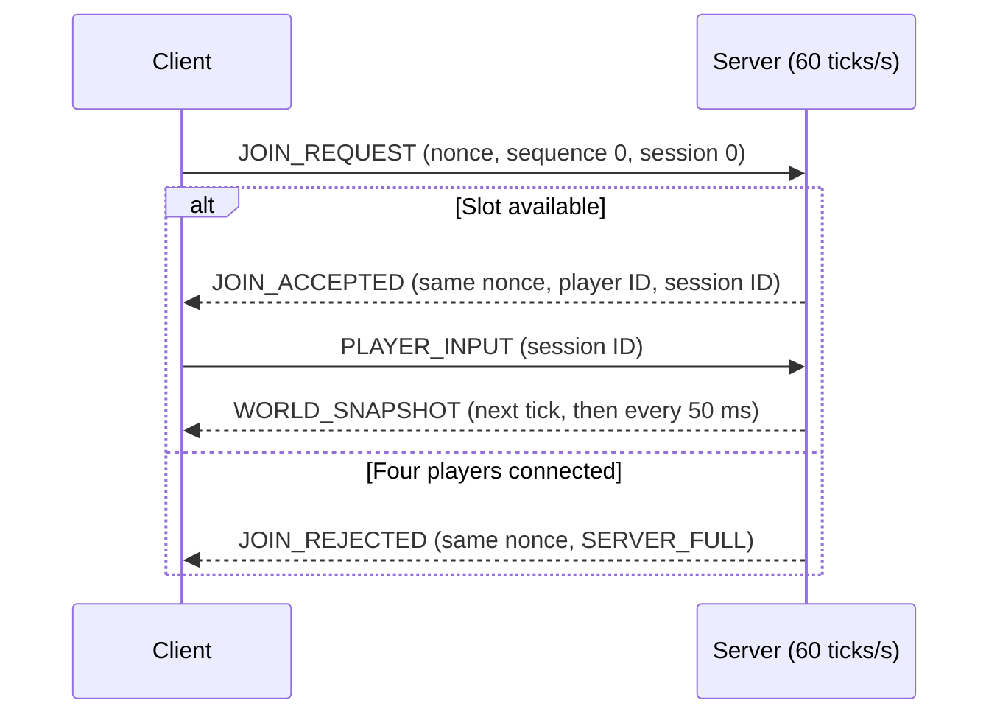
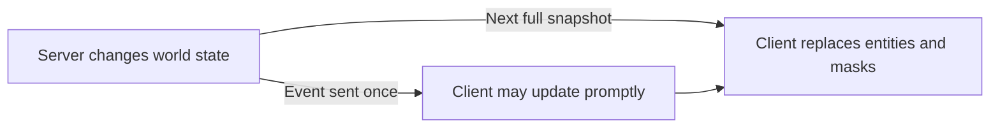

# R-Type UDP protocol (session and input phase)

This version implements the network layer for one game with up to four player
sessions. It handles joins, disconnects, errors, and input commands. The server
runs fixed network ticks, but does not create entities, simulate gameplay, or
send world snapshots. An ECS integration will consume the inputs and define the
world messages later. This is a partial implementation of the Part 1 assignment.

## Transport and encoding

- All messages use UDP. One datagram contains exactly one packet of at most
  1200 bytes, including its header.
- Fields have no padding. Multi-byte integers are big-endian.
- Protocol version is `1`. `u8`, `u16`, `u32`, and `u64` are unsigned integers
  of the stated bit width.

### Common header (16 bytes)

| Offset | Size | Type | Field | Meaning |
| ---: | ---: | --- | --- | --- |
| 0 | 4 | bytes | `magic` | ASCII `RTYP` (`52 54 59 50` in hex) |
| 4 | 1 | `u8` | `version` | `1` |
| 5 | 1 | `u8` | `type` | One of the packet types below |
| 6 | 2 | `u16` | `payload_size` | Bytes after the header |
| 8 | 4 | `u32` | `sequence` | Sender's packet sequence number |
| 12 | 4 | `u32` | `session_id` | Server-assigned session; `0` before joining |

The datagram length must equal `16 + payload_size`. Join messages and `ERROR`
use sequence `0`. Session packets use nonzero sequence numbers, incremented by
the sender and skipping `0` on wraparound. Sequence `a` is newer than `b` when
`0 < ((a - b) mod 2^32) < 2^31`.

### Packet types

| Value | Name | Direction | Payload size |
| ---: | --- | --- | ---: |
| `0x01` | `JOIN_REQUEST` | Client to server | 8 |
| `0x02` | `JOIN_ACCEPTED` | Server to client | 9 |
| `0x03` | `JOIN_REJECTED` | Server to client | 9 |
| `0x04` | `DISCONNECT` | Client to server | 0 |
| `0x05` | `PLAYER_LEFT` | Server to clients | 10 |
| `0x10` | `PLAYER_INPUT` | Client to server | 1 |
| `0x20` | `WORLD_SNAPSHOT` | Server to client | `11 + 16 * entity_count` |
| `0x21` | `ENTITY_SPAWN` | Server to clients | 24 |
| `0x22` | `ENTITY_DESTROY` | Server to clients | 12 |
| `0x23` | `ENTITY_DAMAGE` | Server to clients | 13 |
| `0x24` | `PLAYER_DEATH` | Server to clients | 13 |
| `0x67` | `ERROR` | Server to client | 7 |

The header's `type` identifies the message; payloads have no command code.
A projectile `ENTITY_SPAWN` also signals that someone fired.

## Joining and sessions

Players can join mid-game while a slot is free; there is no ready state.



The client picks a fresh random `u64 client_nonce`. The server assigns an
unused player ID (`0`-`3`) and a nonzero `u32 session_id` that it never reuses
during that run.

| Packet | Payload fields in wire order |
| --- | --- |
| `JOIN_REQUEST` | `client_nonce: u64` |
| `JOIN_ACCEPTED` | `client_nonce: u64`, `player_id: u8` |
| `JOIN_REJECTED` | `client_nonce: u64`, `reason: u8` |

A join request uses sequence `0` and session ID `0`. Join responses use
sequence `0` and echo the nonce. A rejection has session ID `0`; reason `1`
means `SERVER_FULL`. The server also rejects new sessions after exhausting its
nonzero session IDs.

The client may retry the same request and nonce every 500 ms, up to 10
attempts. While the session is active, the server repeats its acceptance for
that nonce without creating another player. Reconnecting after leaving
requires a new nonce. The session ID alone selects a session; it has no login
or identity. A repeated join or valid in-session packet updates the session's
return address and port.

`DISCONNECT` has no payload and requires a nonzero sequence and a valid
session ID. On disconnect, or after 5 seconds without a valid client packet,
the server frees the slot and sends `PLAYER_LEFT` to remaining clients. Its
payload is `server_tick: u64`, `player_id: u8`, `reason: u8`, where reason `1`
means explicit disconnect and `2` means timeout. The tick counts fixed network
updates, starting at `1`; it does not represent a simulated world state.

A lost `DISCONNECT` delays removal until the timeout. `PLAYER_LEFT` is sent
once without acknowledgement and may be lost. Until world snapshots are added,
clients cannot repair a missed departure from server state. Clients should
continue sending input while connected; this phase sends no periodic server
heartbeat.

## Input commands and timing

The server processes queued datagrams at 60 fixed ticks per second. Clients
send their full button state on each change and every 50 ms, including when
idle. Periodic input refreshes the session and replaces lost commands; it does
not request a reply. After 250 ms without a newer input, the server exposes
all buttons as released for that tick. The session itself expires after 5
seconds without a valid client packet.

`PLAYER_INPUT` contains one `u8 buttons` field:

| Bit | Button |
| ---: | --- |
| 0 | Up |
| 1 | Down |
| 2 | Left |
| 3 | Right |
| 4 | Fire |
| 5-7 | Reserved; must be zero |

Up + Right + Fire is `00011001` (`0x19`). The server retains the latest valid
input sequence and button state for each session. It discards duplicate or
older input sequences. Any valid in-session packet updates the session's
last-heard time, even if its input sequence is old. No movement, shooting, or
other gameplay action is performed in this phase.

`GameServer::tick()` returns `TickInput` with a four-entry `buttons` array and
a `connectedMask`. A future ECS system can consume that value on each game
tick. `GameServer::run()` currently schedules these ticks and discards the
returned value. No separate input queue or command broadcast is implemented.

## Packet validation and errors

Clients can predict their own ship from local input and correct it with server
snapshots. Other entities can be interpolated between snapshots. The server
still decides collisions and damage. Exact input replay is not specified:
snapshots do not acknowledge the input sequence or tick the server applied.

## World state

The world is 1280 × 720 logical pixels. Positions locate sprite centers in
1/16-pixel units (`x = 160` means 10 pixels from the left edge). Entities may
briefly be outside the visible area. Clients scale coordinates to their window.

Each networked entity has a `u32 entity_id`, never reused during a server run.
At most 64 players, enemies, and projectiles are active; the server delays
spawns at this limit. The largest snapshot is 1051 bytes including its header.
The locally rendered starfield does not count.

### Entity record (16 bytes)

| Offset | Size | Type | Field | Meaning |
| ---: | ---: | --- | --- | --- |
| 0 | 4 | `u32` | `entity_id` | Unique entity ID |
| 4 | 1 | `u8` | `kind` | Entity kind below |
| 5 | 1 | `u8` | `owner_player_id` | `0`-`3` for a player or their projectile; `255` otherwise |
| 6 | 1 | `u8` | `variant` | Visual variant within the kind |
| 7 | 1 | `u8` | `health` | Current health; `0` for projectiles |
| 8 | 4 | `i32` | `x` | Horizontal position in 1/16 logical pixels |
| 12 | 4 | `i32` | `y` | Vertical position in 1/16 logical pixels |

| Kind | Value | Owner |
| --- | ---: | --- |
| Player ship | `1` | Its player ID |
| Enemy | `2` | `255` |
| Player projectile | `3` | Firing player's ID |
| Enemy projectile | `4` | `255` |

For player ships, `variant` equals the player ID. Render IDs `0`-`3` in blue,
red, green, and yellow respectively. Other kinds use variant `0` as their base
appearance; clients may show that base for unknown non-player variants.

### Full snapshot

The server sends a full `WORLD_SNAPSHOT` every 50 ms and at the next tick
boundary after a join. It reflects all changes through `server_tick`.

| Offset | Size | Type | Field |
| ---: | ---: | --- | --- |
| 0 | 8 | `u64` | `server_tick` |
| 8 | 1 | `u8` | `connected_mask` |
| 9 | 1 | `u8` | `alive_mask` |
| 10 | 1 | `u8` | `entity_count` (`0`-`64`) |
| 11 | `16 * entity_count` | bytes | Consecutive entity records |

Bit `n` of `connected_mask` means player `n` has a session. Bit `n` of
`alive_mask` means their ship is alive and must be clear when they are
disconnected. Bits 4-7 of both masks are zero.



Each snapshot contains **all** active entities. The client replaces its entity
set and masks when `server_tick` is newer, so absent entities disappear and a
later snapshot repairs lost events. Ignore snapshots at or before the last
applied tick.

### Events

Events provide prompt effects between snapshots. Each is sent once and starts
with `server_tick: u64`, followed by:

| Type | Remaining payload fields in wire order |
| --- | --- |
| `ENTITY_SPAWN` | One complete 16-byte entity record |
| `ENTITY_DESTROY` | `entity_id: u32` |
| `ENTITY_DAMAGE` | `entity_id: u32`, `remaining_health: u8` |
| `PLAYER_DEATH` | `player_id: u8`, `entity_id: u32` |

`PLAYER_DEATH` removes the ship and clears its alive bit, but can leave the
session connected. `ENTITY_DESTROY` covers enemies and projectiles. Respawning
a player uses `ENTITY_SPAWN` with a new entity ID. Ignore events at or before
the last applied snapshot tick. `ENTITY_DAMAGE` reports surviving health; at
zero, the server sends `ENTITY_DESTROY` or `PLAYER_DEATH` instead.

## Packet handling and errors

Before using fields or allocating, both programs validate datagram size,
magic, version, type, exact payload length, field ranges, and entity count.
Discard unknown types, wrong-direction packets, and invalid fields. Reject
unknown in-session IDs; join packets follow the join rules instead. Reserved
input bits are invalid. The server never accepts client coordinates, health,
collisions, or damage decisions.

### Error response

For a malformed client datagram with at least the 16-byte header and `RTYP`
magic, the server sends `ERROR` to its source address and port. It does not
respond to shorter datagrams, wrong magic, or `ERROR` packets. `ERROR` uses
version `1`, sequence `0`, session ID `0`, and this seven-byte payload:

| Offset | Size | Type | Field | Meaning |
| ---: | ---: | --- | --- | --- |
| 0 | 1 | `u8` | `code` | Error code below |
| 1 | 1 | `u8` | `offending_type` | Type byte from rejected packet |
| 2 | 4 | `u32` | `offending_sequence` | Sequence from rejected packet |
| 6 | 1 | `u8` | `detail` | Supported version for `UNSUPPORTED_VERSION`; `0` otherwise |

| Code | Name | Cause |
| ---: | --- | --- |
| `1` | `UNSUPPORTED_VERSION` | Header version is not `1` |
| `2` | `INVALID_LENGTH` | Datagram exceeds 1200 bytes or its length does not match |
| `3` | `UNKNOWN_TYPE` | Type byte has no definition in version `1` |
| `4` | `WRONG_DIRECTION` | A client sent a server-only packet |
| `5` | `INVALID_SESSION` | An in-session packet has an unknown session ID |
| `6` | `INVALID_FIELD` | A field is outside its allowed values |

Report the first failure in this order: version, datagram size and declared
length, known type, direction, session, type-specific payload length, then
field values. An unsupported-version error has `detail = 1`.

## Example input datagram

This is a complete 17-byte `PLAYER_INPUT` packet for session `0x12345678`,
client sequence `1`, and Up + Right + Fire:

```text
52 54 59 50   magic = "RTYP"
01            version = 1
10            type = PLAYER_INPUT
00 01         payload_size = 1
00 00 00 01   sequence = 1
12 34 56 78   session_id = 0x12345678
19            buttons = UP | RIGHT | FIRE
```
