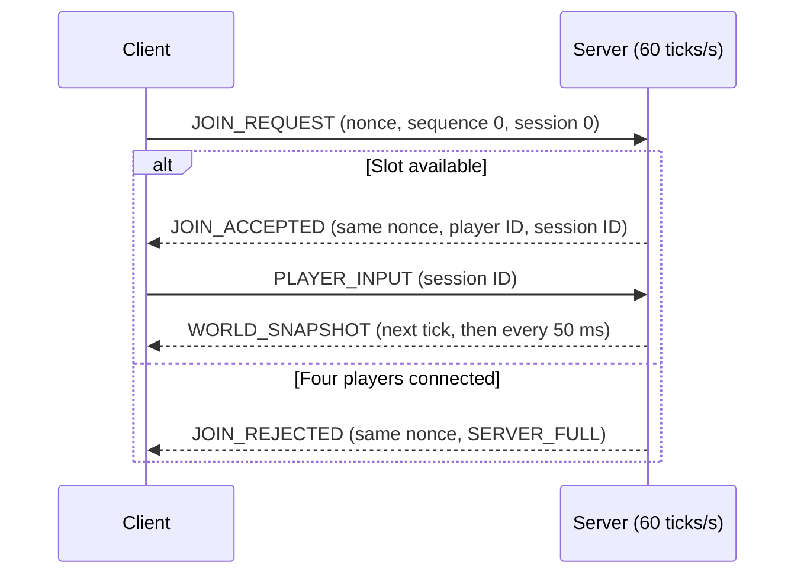
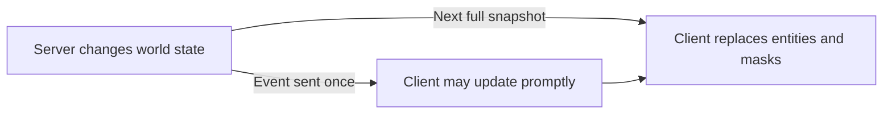

# R-Type UDP protocol (draft, Part 1)

This is the wire protocol for the four-week prototype: one continuously running
game with up to four players. The server controls movement, projectiles,
collisions, damage, and deaths; clients send only button states. Each client
renders its own starfield. This version has no lobbies, accounts, chat, or
multiple games.

## Transport and encoding

- All packet types below use UDP; this version opens no TCP connection. One
  datagram contains exactly one packet of at most 1200 bytes, including the
  header. The server address and port are configured separately; there is no
  discovery message.
- Fields have no padding. Multi-byte integers are big-endian; signed integers
  use two's complement.
- Version `1` defines the layouts below.
- `u8`, `u16`, `u32`, and `u64` are unsigned integers of the stated bit width;
  `i32` is a signed 32-bit integer.

### Common header (16 bytes)

| Offset | Size | Type | Field | Meaning |
| ---: | ---: | --- | --- | --- |
| 0 | 4 | bytes | `magic` | ASCII `RTYP` (`52 54 59 50` in hex) |
| 4 | 1 | `u8` | `version` | `1` |
| 5 | 1 | `u8` | `type` | One of the packet types below |
| 6 | 2 | `u16` | `payload_size` | Bytes following the 16-byte header |
| 8 | 4 | `u32` | `sequence` | Sender's packet sequence number |
| 12 | 4 | `u32` | `session_id` | Session assigned by the server; `0` before joining |

The datagram length must equal `16 + payload_size`. Join messages and `ERROR`
use sequence `0`. After joining, each side independently numbers packets to
that session from `1`, incrementing per packet and skipping `0` on wraparound.
Sequence `a` is newer than `b` when `0 < ((a - b) mod 2^32) < 2^31`.

### Packet types

| Value | Name | Direction | Payload size |
| ---: | --- | --- | ---: |
| `0x01` | `JOIN_REQUEST` | Client to server | 8 |
| `0x02` | `JOIN_ACCEPTED` | Server to client | 9 |
| `0x03` | `JOIN_REJECTED` | Server to client | 9 |
| `0x04` | `DISCONNECT` | Client to server | 0 |
| `0x05` | `PLAYER_LEFT` | Server to clients | 10 |
| `0x10` | `PLAYER_INPUT` | Client to server | 1 |
| `0x20` | `WORLD_SNAPSHOT` | Server to client | `11 + 16 * entity_count` |
| `0x21` | `ENTITY_SPAWN` | Server to clients | 24 |
| `0x22` | `ENTITY_DESTROY` | Server to clients | 12 |
| `0x23` | `ENTITY_DAMAGE` | Server to clients | 13 |
| `0x24` | `PLAYER_DEATH` | Server to clients | 13 |
| `0x67` | `ERROR` | Server to client | 7 |

The header's `type` identifies the message; payloads have no command code.
A projectile `ENTITY_SPAWN` also signals that someone fired.

## Joining and sessions

Players can join mid-game while a slot is free; there is no ready state.



The client picks a fresh random `u64 client_nonce`. The server assigns an
unused player ID (`0`-`3`) and a nonzero `u32 session_id` that it never reuses
during that run.

| Packet | Payload fields in wire order |
| --- | --- |
| `JOIN_REQUEST` | `client_nonce: u64` |
| `JOIN_ACCEPTED` | `client_nonce: u64`, `player_id: u8` |
| `JOIN_REJECTED` | `client_nonce: u64`, `reason: u8` |

Join responses use sequence `0` and echo the nonce. A rejection has session
ID `0`; reason `1` means `SERVER_FULL`. Unsupported versions receive `ERROR`.

The client retries the same request and nonce every 500 ms, up to 10 attempts.
While the session is active, the server repeats its acceptance for that nonce
without creating another player. Reconnecting after leaving requires a new
nonce.

The session ID alone selects a session; it has no login or identity. The join
request's source address and port become its return address. A repeated join
or later valid in-session packet updates that address, even if it differs from
the original.

`DISCONNECT` has no payload and requires a nonzero session ID. On disconnect,
or after 5 seconds without a client packet, the server removes the session and
ship, frees the slot, and sends `PLAYER_LEFT` to remaining clients. A lost
`DISCONNECT` delays removal until that timeout. After 5 seconds without a
server packet, the client treats its session as lost and may rejoin with a new
nonce.

`PLAYER_LEFT` contains `server_tick: u64`, `player_id: u8`, and `reason: u8`
(`1` = disconnect, `2` = timeout). Snapshot masks also show departures if the
event is lost.

## Input and game timing

The server runs at 60 ticks/s, processing joins, leaves, and the latest input
at tick boundaries. Clients send their full button state on each change and
every 50 ms, even when idle. This resend replaces lost input and keeps the
session active; it does not request a reply. Periodic input costs 340 protocol
bytes/s per player, plus sends on changes. After 250 ms without input, the
server treats all buttons as released. Dead players still send input to keep
their session active, but their controls have no gameplay effect.

`PLAYER_INPUT` contains one `u8 buttons` field:

| Bit | Button |
| ---: | --- |
| 0 | Up |
| 1 | Down |
| 2 | Left |
| 3 | Right |
| 4 | Fire |
| 5-7 | Reserved; must be zero |

Up + Right + Fire is `00011001` (`0x19`). Opposing directions cancel on their
axis. Fire stays held; the server applies its firing cooldown. Clients cannot
command damage, death, enemy movement, or projectile positions.

The server discards duplicate or older input sequences. Newer input replaces
the previous state. Any valid in-session packet updates the session's
last-heard time. Sequence numbers establish order, not age: a delayed packet
can briefly apply after the 250 ms timeout if no newer one arrived. A short
Fire tap can be missed if its only packet is lost.

### What the client renders

Clients can predict their own ship from local input and correct it with server
snapshots. Other entities can be interpolated between snapshots. The server
still decides collisions and damage. Exact input replay is not specified:
snapshots do not acknowledge the input sequence or tick the server applied.

## World state

The world is 1280 × 720 logical pixels. Positions locate sprite centers in
1/16-pixel units (`x = 160` means 10 pixels from the left edge). Entities may
briefly be outside the visible area. Clients scale coordinates to their window.

Each networked entity has a `u32 entity_id`, never reused during a server run.
At most 64 players, enemies, and projectiles are active; the server delays
spawns at this limit. The largest snapshot is 1051 bytes including its header.
The locally rendered starfield does not count.

### Entity record (16 bytes)

| Offset | Size | Type | Field | Meaning |
| ---: | ---: | --- | --- | --- |
| 0 | 4 | `u32` | `entity_id` | Unique entity ID |
| 4 | 1 | `u8` | `kind` | Entity kind below |
| 5 | 1 | `u8` | `owner_player_id` | `0`-`3` for a player or their projectile; `255` otherwise |
| 6 | 1 | `u8` | `variant` | Visual variant within the kind |
| 7 | 1 | `u8` | `health` | Current health; `0` for projectiles |
| 8 | 4 | `i32` | `x` | Horizontal position in 1/16 logical pixels |
| 12 | 4 | `i32` | `y` | Vertical position in 1/16 logical pixels |

| Kind | Value | Owner |
| --- | ---: | --- |
| Player ship | `1` | Its player ID |
| Enemy | `2` | `255` |
| Player projectile | `3` | Firing player's ID |
| Enemy projectile | `4` | `255` |

For player ships, `variant` equals the player ID. Render IDs `0`-`3` in blue,
red, green, and yellow respectively. Other kinds use variant `0` as their base
appearance; clients may show that base for unknown non-player variants.

### Full snapshot

The server sends a full `WORLD_SNAPSHOT` every 50 ms and at the next tick
boundary after a join. It reflects all changes through `server_tick`.

| Offset | Size | Type | Field |
| ---: | ---: | --- | --- |
| 0 | 8 | `u64` | `server_tick` |
| 8 | 1 | `u8` | `connected_mask` |
| 9 | 1 | `u8` | `alive_mask` |
| 10 | 1 | `u8` | `entity_count` (`0`-`64`) |
| 11 | `16 * entity_count` | bytes | Consecutive entity records |

Bit `n` of `connected_mask` means player `n` has a session. Bit `n` of
`alive_mask` means their ship is alive and must be clear when they are
disconnected. Bits 4-7 of both masks are zero.



Each snapshot contains **all** active entities. The client replaces its entity
set and masks when `server_tick` is newer, so absent entities disappear and a
later snapshot repairs lost events. Ignore snapshots at or before the last
applied tick.

### Events

Events provide prompt effects between snapshots. Each is sent once and starts
with `server_tick: u64`, followed by:

| Type | Remaining payload fields in wire order |
| --- | --- |
| `ENTITY_SPAWN` | One complete 16-byte entity record |
| `ENTITY_DESTROY` | `entity_id: u32` |
| `ENTITY_DAMAGE` | `entity_id: u32`, `remaining_health: u8` |
| `PLAYER_DEATH` | `player_id: u8`, `entity_id: u32` |

`PLAYER_DEATH` removes the ship and clears its alive bit, but can leave the
session connected. `ENTITY_DESTROY` covers enemies and projectiles. Respawning
a player uses `ENTITY_SPAWN` with a new entity ID. Ignore events at or before
the last applied snapshot tick. `ENTITY_DAMAGE` reports surviving health; at
zero, the server sends `ENTITY_DESTROY` or `PLAYER_DEATH` instead.

## Packet handling and errors

Before using fields or allocating, both programs validate datagram size,
magic, version, type, exact payload length, field ranges, and entity count.
Discard unknown types, wrong-direction packets, and invalid fields. Reject
unknown in-session IDs; join packets follow the join rules instead. Reserved
input bits are invalid. The server never accepts client coordinates, health,
collisions, or damage decisions.

### Error response

For a malformed client datagram with at least the 16-byte header and `RTYP`
magic, the server sends `ERROR` to its source address and port. It does not
respond to shorter datagrams, wrong magic, or `ERROR` packets.

`ERROR` always uses protocol version `1`, `sequence = 0`, and
`session_id = 0`. Its seven-byte payload is:

| Offset | Size | Type | Field | Meaning |
| ---: | ---: | --- | --- | --- |
| 0 | 1 | `u8` | `code` | Error code below |
| 1 | 1 | `u8` | `offending_type` | Type byte from the rejected packet |
| 2 | 4 | `u32` | `offending_sequence` | Sequence from the rejected packet |
| 6 | 1 | `u8` | `detail` | Supported version for `UNSUPPORTED_VERSION`; `0` otherwise |

| Code | Name | Cause |
| ---: | --- | --- |
| `1` | `UNSUPPORTED_VERSION` | Header version is not `1` |
| `2` | `INVALID_LENGTH` | Datagram exceeds 1200 bytes or its length does not match the message layout |
| `3` | `UNKNOWN_TYPE` | Type byte has no definition in version `1` |
| `4` | `WRONG_DIRECTION` | A client sent a server-only packet |
| `5` | `INVALID_SESSION` | An in-session packet has `0` or an unknown session ID |
| `6` | `INVALID_FIELD` | A field is outside its allowed values, including reserved bits |

Report the first failure in this order: version → datagram size and declared
length → known type → direction → session → type-specific payload length →
field values. Both length checks use `INVALID_LENGTH`. For
`UNSUPPORTED_VERSION`, `detail = 1` names the supported version. Clients accept
`ERROR` with session ID `0` even after joining and match it by
`offending_type` and `offending_sequence`. An unsupported-version error ends
the join attempt; report the mismatch instead of retrying.

A version `2` `JOIN_REQUEST` with the common header gets
`UNSUPPORTED_VERSION` with `detail = 1`. Events have no acknowledgements or
retransmissions.

## Example input datagram

This is a complete 17-byte `PLAYER_INPUT` packet for session `0x12345678`,
client sequence `1`, and Up + Right + Fire:

```text
52 54 59 50   magic = "RTYP"
01            version = 1
10            type = PLAYER_INPUT
00 01         payload_size = 1
00 00 00 01   sequence = 1
12 34 56 78   session_id = 0x12345678
19            buttons = UP | RIGHT | FIRE
```
